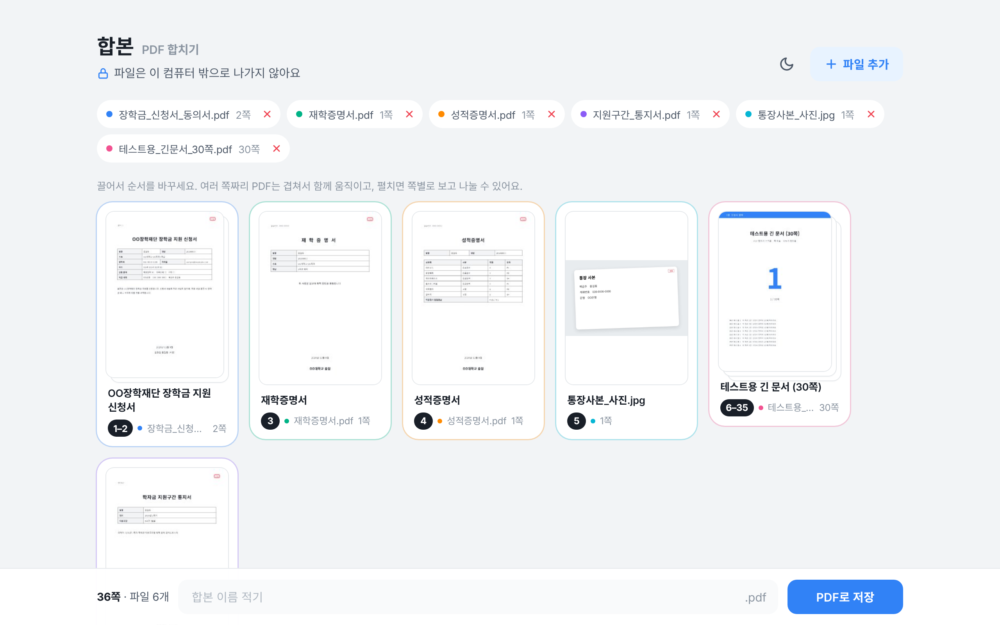
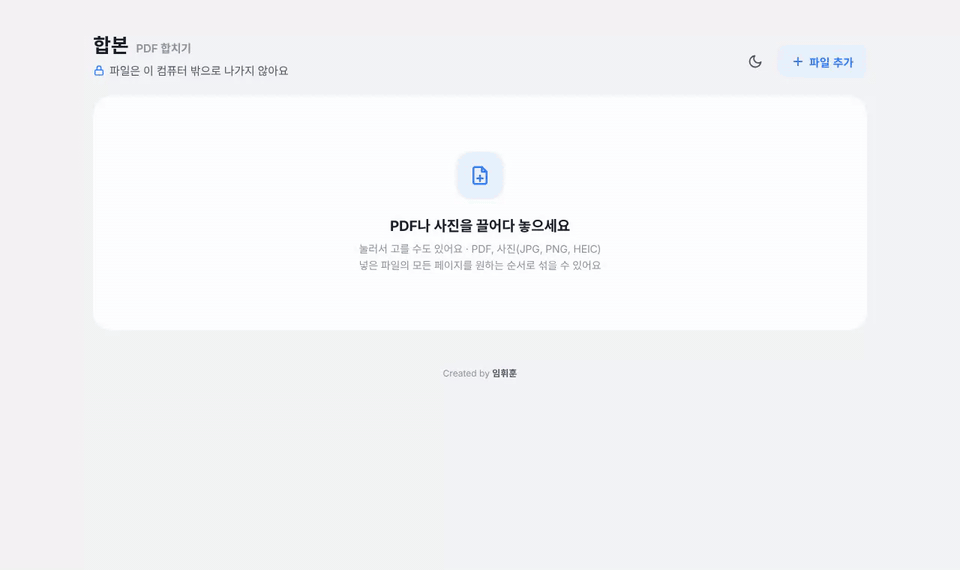

# Hapbon (합본)

**Merge PDFs and photos into one file, in any order you want.**
Everything runs inside your browser. Your files are never uploaded anywhere.

<p>
  <a href="https://iimmuunnee.github.io/hapbon/"><b>Try it now</b></a>
  &nbsp;·&nbsp; <a href="README.md">한국어</a>
</p>

> The interface is in Korean for now. The icons and drag-and-drop work the same in any language.



## Why

I had to submit seven documents for a scholarship application as **a single PDF**: application form, enrollment certificate, transcript, an income bracket notice, a resident registration copy, a bank book copy and a consent form.

- My office suite charged extra for merging PDFs.
- Free online PDF sites and AI tools would have been convenient, but these documents contain **national ID numbers and bank account numbers**. Once uploaded, a file sits on someone else's server, and you cannot know how long it is kept or how well it is protected. An ID number cannot be changed after a leak.
- The income bracket notice was a **password-protected PDF**.
- The application form and the consent form were **in the same PDF**, so I had to split them and put other documents in between.

So I built a tool that solves all of this **without a server**.

## Verify it yourself

1. **Turn off your internet.** Open `index.html` offline. Everything still works.
2. **Open DevTools → Network** (`F12`, or `⌥⌘I` on Mac). Add files, merge and save. Apart from loading the page itself, no request leaves your device.
3. **Check the security policy.** The page ships a strict `Content-Security-Policy` with `connect-src 'none'` and `default-src 'none'`, so the browser itself blocks any network request or external resource, even if malicious code were ever added.
4. **Read the code.** All UI and logic live in [`src/app.html.tpl`](src/app.html.tpl).

## Demo



The documents in the demo are samples with no real personal data.

## Features

- **Mix PDFs and photos** (JPG, PNG, HEIC, WEBP). Photos are fitted to an A4 page.
- **Password-protected PDFs**: enter the password and the pages are added unlocked.
- **Stacked cards**: a multi-page PDF is shown as one stacked card and moves as a group, so a long document never gets scattered.
- **Automatic titles**: the largest heading on the first page becomes the card title.
- **Expand and split**: expand a card into a one-row strip with a scrollbar, jump to a page by number, and split with the scissors button.
- **Rotate, remove, preview** any page.
- **Undo** everything with `Ctrl+Z` / `⌘Z` (up to 50 steps).
- **Light and dark mode**, following your system setting by default.
- **Korean CMaps built in**, so Korean government PDFs render correctly.
- Leave the file name empty and it is saved as `합본_YYYY-MM-DD.pdf`.

## Download

1. Click **`index.html`** in this repository.
2. Press the **Download raw file** button at the top right.
3. Double-click the downloaded file. No install, no account, no internet required.

## Build

```bash
npm install
npm run build   # src/app.html.tpl → index.html
```

Python 3 is required for the build script.

## Built with

- [pdf-lib](https://github.com/Hopding/pdf-lib) (MIT)
- [PDF.js](https://github.com/mozilla/pdf.js) (Apache-2.0)
- [SortableJS](https://github.com/SortableJS/Sortable) (MIT)

## License

MIT

---

Created by **임휘훈 (Hwihoon Lim)**
