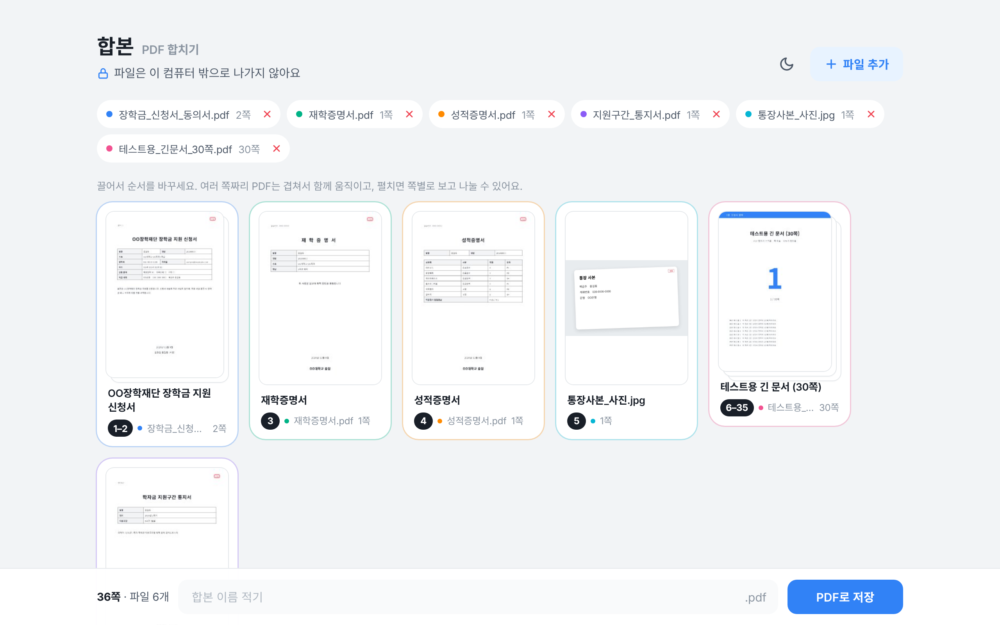
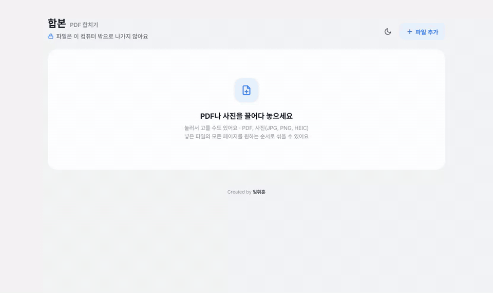
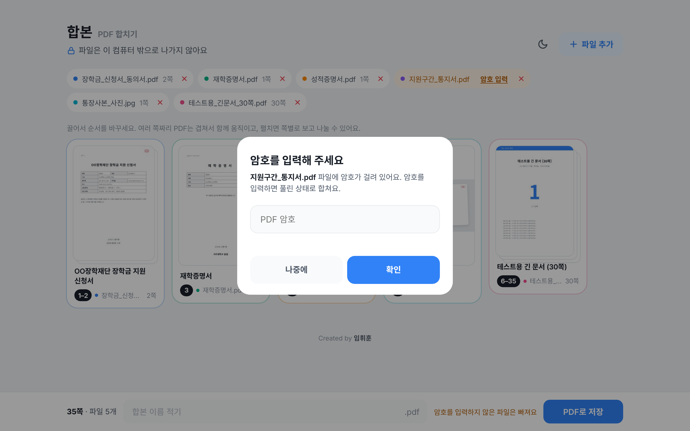
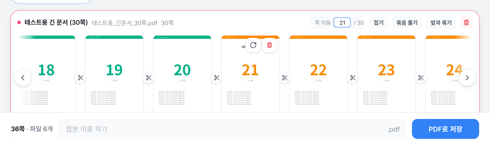
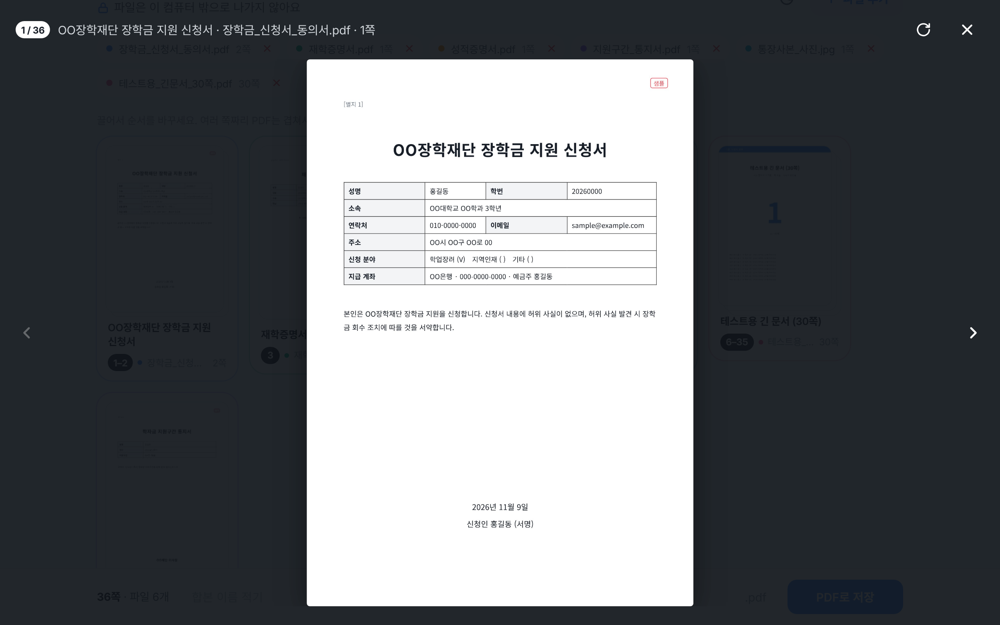
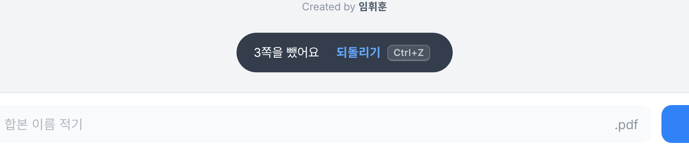
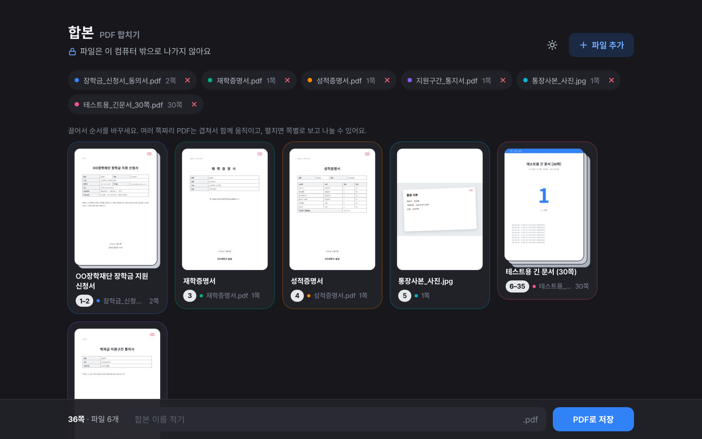
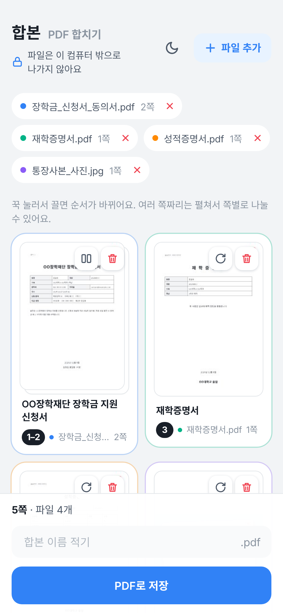

# 합본

**PDF와 사진을 원하는 순서대로 한 파일로 합치는 도구예요.**
모든 작업이 내 기기 안에서만 이루어지고, 파일은 어디에도 업로드되지 않아요.

> **바로 쓰기**: 이 저장소의 [`index.html`](index.html) 파일 하나를 내려받아 브라우저로 열면 돼요. 설치도, 회원가입도, 인터넷 연결도 필요 없어요.



---

## 만들게 된 계기

장학금을 신청하면서 신청서, 재학증명서, 성적증명서, 학자금 지원구간 통지서, 주민등록등본, 통장 사본, 개인정보 동의서까지 **7개 서류를 PDF 하나로 합쳐서** 올려야 했어요.

그런데 막상 해보니 걸리는 게 많았어요.

- 쓰던 오피스 프로그램은 PDF 합치기가 **유료 기능**이었어요.
- 무료 온라인 PDF 사이트나 AI 서비스에 올리면 편하긴 하겠지만, **주민등록번호와 계좌번호가 들어간 서류**를 그렇게 올리기가 꺼려졌어요.
- 한국장학재단 통지서는 **암호가 걸린 PDF**라 그대로 합칠 수 없었어요.
- 신청서와 동의서가 **한 PDF 안에 같이 들어 있어서**, 공고에 나온 순서대로 놓으려면 페이지를 나눠서 사이사이에 다른 서류를 끼워야 했어요.

그래서 이 문제를 전부 해결하는 도구를 직접 만들었어요. 나와 같은 상황인 사람들도 편하게 쓸 수 있게 공개해요.

---

## 왜 "내 기기 안에서만"이 중요한가요?

요즘은 PDF를 합치거나, 서류 내용을 정리하거나, 표를 고치는 일도 **AI 서비스나 온라인 사이트에 파일을 올리면 금방 끝나요.** 편하다 보니 무심코 개인정보가 담긴 서류까지 올리게 되죠.

하지만 파일을 올리는 순간, 그 파일은 **내 손을 떠나 다른 회사의 서버에 저장돼요.**

- 서비스마다 업로드한 파일을 **얼마나 오래 보관하는지, 어디에 쓰는지**가 다르고, 이용약관을 꼼꼼히 읽지 않으면 알기 어려워요.
- 서버가 **해킹당하거나 내부 관리가 허술하면**, 그 안에 쌓인 서류가 한꺼번에 새어 나갈 수 있어요. 대규모 개인정보 유출 소식은 이제 낯설지 않은 뉴스가 됐어요.
- 무료 사이트 중에는 **운영 주체가 불분명한 곳**도 있어서, 내 파일이 어디로 가는지조차 확인하기 어려워요.
- 비밀번호는 바꾸면 되지만, **주민등록번호, 계좌번호, 주소는 한 번 새어 나가면 되돌리기 어려워요.**

합본은 처음부터 **서버로 파일을 보내지 않는 구조**로 만들었어요.

- PDF를 읽고, 썸네일을 그리고, 암호를 풀고, 합치는 모든 과정이 **브라우저 안에서** 일어나요.
- 파일을 받을 서버 자체가 없어서, **유출될 곳이 없어요.**
- 창을 닫으면 넣었던 파일과 작업 내용이 모두 사라져요.

### 직접 확인해 보세요

"안전하다"는 말만 믿을 필요는 없어요.

1. **인터넷을 끄고 써보세요.** 와이파이를 끄고 `index.html`을 열어도 모든 기능이 그대로 동작해요. 인터넷이 없어도 되는 건 어디에도 파일을 보내지 않는다는 뜻이에요.
2. **개발자 도구로 확인해 보세요.** 브라우저에서 `F12` (Mac은 `⌥⌘I`) → **네트워크(Network)** 탭을 열어둔 채로 파일을 넣고 저장해 보세요. 페이지를 여는 요청 말고는, 파일을 넣고 합치고 저장하는 동안 밖으로 나가는 요청이 하나도 없어요.
3. **코드를 직접 보세요.** 화면과 동작 코드는 [`src/app.html.tpl`](src/app.html.tpl) 한 파일에 모두 들어 있어요.

---

## 사용 방법

1. `index.html`을 내려받아 크롬, 엣지, 사파리 같은 브라우저로 열어요.
2. 합칠 PDF나 사진을 화면에 **끌어다 놓거나**, 눌러서 골라요. 여러 개를 한 번에 넣을 수 있어요.
3. 카드를 **끌어서** 원하는 순서로 놓아요.
4. 한 PDF를 중간에 나눠야 하면 카드의 **펼치기**를 누르고, 페이지 사이의 **가위**를 눌러 나눠요.
5. 아래 칸에 파일 이름을 적고 **PDF로 저장**을 누르면 끝이에요.

### 예시: 장학금 서류를 공고 순서대로 합치기

```
신청서 → 재학증명서 → 성적증명서 → 지원구간 통지서 → 통장 사본 → 동의서
```



1. 서류를 한꺼번에 넣어요. 지원구간 통지서처럼 암호가 걸린 파일은 넣는 순간 암호 입력 창이 떠요.
2. **파일 추가**로 통장 사본 사진도 넣어요. 사진은 세로 A4 한 장에 맞춰 들어가요.
3. 신청서와 동의서가 같이 든 PDF는 **펼치기**를 누르고, 두 쪽 사이를 **가위**로 잘라요. 나뉜 카드는 제목이 각각 따로 인식돼요.
4. 동의서 카드를 맨 뒤로 끌어 놓고, 이름을 적어 저장하면 끝이에요.

> 데모에 쓴 서류는 모두 개인정보가 없는 **샘플**이에요.

---

## 기능

### 넣기
- **PDF와 사진을 섞어서** 합칠 수 있어요. 사진은 JPG, PNG, HEIC(아이폰 사진), WEBP 모두 돼요.
- 사진은 **세로 A4 한 장**에 맞춰 들어가요.
- **암호 걸린 PDF**는 암호를 입력하면 풀린 상태로 들어가요.
- 한국어 PDF를 제대로 읽을 수 있게 **한국어 문자 변환표(CMap)**를 내장했어요. 관공서 서류도 썸네일과 제목이 깨지지 않아요.



### 정리하기
- **겹친 카드**: 여러 쪽짜리 PDF는 첫 페이지 뒤로 종이가 겹친 카드 하나로 보여요. 2쪽이면 2장, 3쪽 이상이면 3장까지 겹쳐요.
- **묶음째 이동**: 같은 PDF의 페이지는 기본으로 묶여 있어서, 끌면 함께 움직여요. 내용은 하나인데 길어서 두 쪽이 된 서류가 흩어지지 않아요.
- **제목 자동 인식**: 첫 페이지에서 가장 큰 제목 줄을 읽어 카드에 보여줘요. `재 학 증 명 서`처럼 띄어 쓴 제목은 `재학증명서`로 붙여서 보여줘요.
- **색깔 구분**: 파일마다 색이 있어서, 이름표와 카드 테두리로 어느 파일인지 한눈에 보여요.
- **돌리기와 빼기**: 페이지를 90도씩 돌리거나 휴지통으로 뺄 수 있어요.

### 펼치기
페이지들이 한 줄로 펼쳐지고, 쪽수가 많아도 영역 높이는 그대로예요.



- 하단 스크롤바, ‹ › 버튼, 마우스 휠, 손가락 밀기로 넘겨요.
- 8쪽이 넘으면 **쪽 번호를 입력해서 바로 이동**할 수 있어요. 이동한 쪽은 파란 테두리로 잠깐 표시돼요.
- 페이지 사이 **가위**로 나누고, `묶음 풀기`로 한 쪽씩 떼고, `앞과 묶기`로 다시 합쳐요.
- 한 번에 하나만 펼쳐져서 화면이 어지럽지 않아요.

### 크게 보기
썸네일을 누르면 크게 보면서 앞뒤로 넘길 수 있어요. 여기서도 바로 돌릴 수 있어요.



### 되돌리기
- 빼기, 나누기, 묶기, 순서 바꾸기, 돌리기를 **모두 되돌릴 수 있어요.** 최근 50번까지 거슬러 갈 수 있어요.
- 알림의 `되돌리기` 버튼이나 단축키로 되돌려요. 단축키는 쓰는 기기에 맞게 `Ctrl+Z` 또는 `⌘Z`로 표시돼요.



### 저장
- 이름을 비워 두면 `합본_2026-11-06.pdf`처럼 **오늘 날짜**로 저장돼요.
- 암호가 풀린 페이지는 고해상도 이미지로 바뀌어 들어가요. 글자 선택은 안 되지만 제출용으로는 충분해요. 나머지 PDF 페이지는 원본 그대로 옮겨져요.

### 라이트 / 다크 모드
- 처음 열면 **기기 설정**(Windows, Mac, 휴대폰의 라이트/다크)을 따라가요.
- 오른쪽 위 **해/달 버튼**으로 바꿀 수 있고, 고른 모드는 다음에 열 때도 기억해요.
- 다크 모드에서도 PDF 썸네일은 **흰 종이 그대로** 보여서, 실제로 제출될 모습을 확인할 수 있어요.



---

## 단축키

| 동작 | Windows / Linux | Mac |
|---|---|---|
| 되돌리기 | `Ctrl` + `Z` | `⌘` + `Z` |
| 크게 보기에서 앞뒤 넘기기 | `←` `→` | `←` `→` |
| 크게 보기, 암호 창 닫기 | `Esc` | `Esc` |
| 펼친 묶음에서 쪽 이동 | 번호 입력 후 `Enter` | 번호 입력 후 `Enter` |

---

## 지원 환경

- **Windows, Mac**: `index.html`을 내려받아 브라우저로 열면 바로 써요.
- **Android, iPhone**: 기기에 저장된 HTML 파일을 바로 여는 게 불편하거나 막혀 있어서, 웹 주소로 여는 걸 추천해요. 이 저장소를 GitHub Pages로 배포하면 링크 하나로 어디서든 열 수 있어요. 웹 주소로 열어도 서버는 화면 파일만 전달하고, PDF 처리는 각자 기기에서 해요.
- 휴대폰에서는 꾹 눌러서 끌고, 손가락으로 밀어서 넘겨요. 단축키 표시는 숨겨져요.



---

## 직접 빌드하기

`index.html`은 `src/app.html.tpl`에 라이브러리를 넣어서 만든 하나짜리 파일이에요.

```bash
npm install
npm run build   # src/app.html.tpl → index.html
```

빌드에는 Python 3가 필요해요.

| 경로 | 설명 |
|---|---|
| `index.html` | 바로 쓰는 완성본 (라이브러리 포함, 약 2MB) |
| `src/app.html.tpl` | 화면과 동작 코드 |
| `scripts/build.py` | 라이브러리와 한국어 CMap을 넣어 `index.html`을 만드는 스크립트 |
| `docs/images/` | README에 쓴 화면 캡처와 데모 |

## 사용한 라이브러리

- [pdf-lib](https://github.com/Hopding/pdf-lib) (MIT) - PDF 합치기, 저장
- [PDF.js](https://github.com/mozilla/pdf.js) (Apache-2.0) - 썸네일, 암호 해제, 제목 인식
- [SortableJS](https://github.com/SortableJS/Sortable) (MIT) - 끌어서 순서 바꾸기

## 라이선스

MIT License. 자유롭게 쓰고, 고치고, 나눠도 돼요.

---

Created by **임휘훈**
